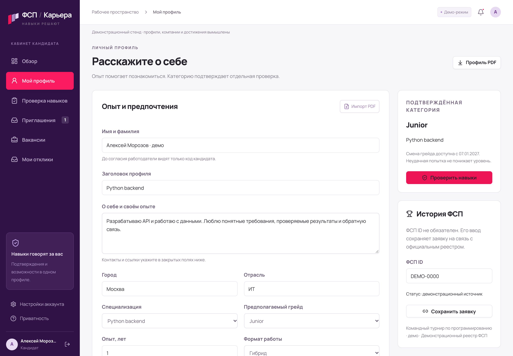
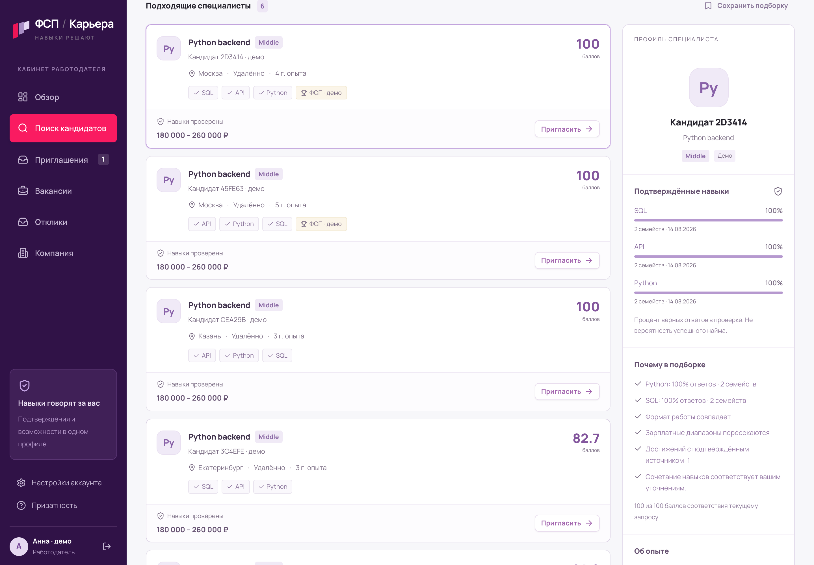
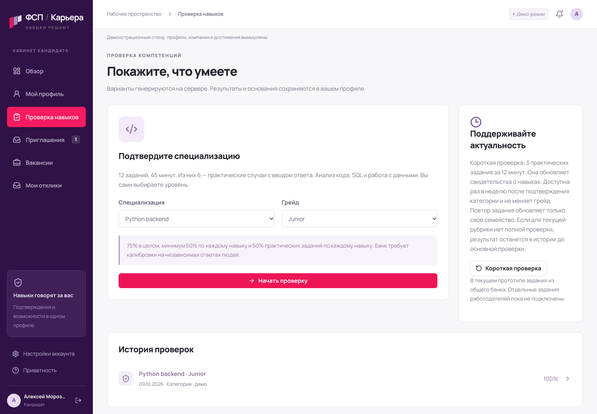
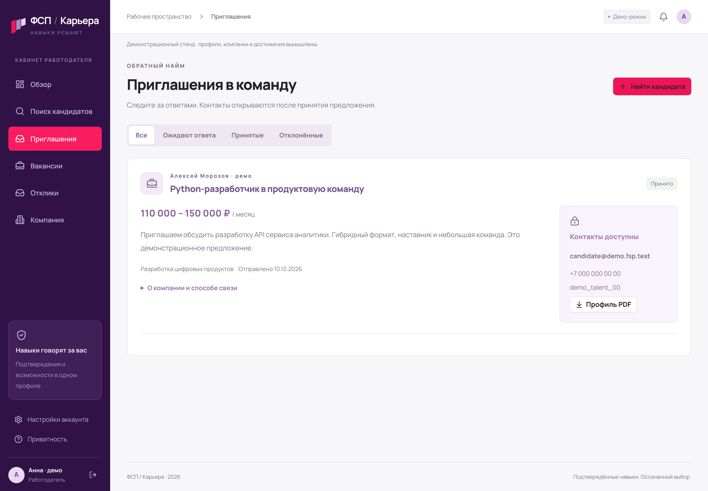

<p align="center">
  
</p>

<p align="center">
  <strong>Проверка навыков · Объяснимый подбор · Обратный найм</strong>
</p>

<p align="center">
  <a href="https://github.com/ars123-create/fsp-career/releases/download/v0.5.1/FSP_Career_Overview_0.5.1.mp4"><strong>▶ Обзор · 2:20</strong></a>
  &nbsp; · &nbsp;
  <a href="https://github.com/ars123-create/fsp-career/releases/download/v0.5.1/FSP_Career_Full_Flow_0.5.1.mp4">Полный сценарий · 3:07</a>
  &nbsp; · &nbsp;
  <a href="https://github.com/ars123-create/fsp-career/releases/download/v0.5.1/FSP_Career_Pitch_0.5.1.pdf">Презентация</a>
  &nbsp; · &nbsp;
  <a href="https://github.com/ars123-create/fsp-career/releases/tag/v0.5.1">Все материалы</a>
</p>

<p align="center">
  <code>v0.5.1</code> &nbsp; <code>FastAPI</code> &nbsp; <code>React 19</code> &nbsp; <code>TypeScript</code> &nbsp; <code>PostgreSQL</code> &nbsp; <code>Docker</code>
</p>

---

**ИТ-карьера начинается с того, что человек умеет.** Кандидат подтверждает навыки и получает предложения с зарплатой. Работодатель находит специалистов, уточняет приоритеты и приглашает в команду. Кандидат сам решает, кому открыть контакты.

Хакатонный прототип для спецтрека Федерации спортивного программирования. Все профили на скриншотах и в видео — вымышленные демонстрационные данные.

## Два кабинета — один путь к предложению

<table>
  <tr>
    <td width="50%"><strong>Кандидату — показать навыки</strong><br>Профиль, подтверждённая категория и история достижений.</td>
    <td width="50%"><strong>Работодателю — найти свою команду</strong><br>Подбор с объяснениями и уточнением приоритетов.</td>
  </tr>
  <tr>
    <td></td>
    <td></td>
  </tr>
</table>

<details>
<summary><strong>Ещё два экрана: проверка навыков и принятое приглашение</strong></summary>

<table>
  <tr>
    <td width="50%"><strong>Навыки подтверждаются отдельно</strong><br>12 заданий, включая 6 практических. Есть короткая повторная проверка.</td>
    <td width="50%"><strong>Контакты — после согласия</strong><br>Принятое предложение, зарплатная вилка и выгрузка профиля в PDF.</td>
  </tr>
  <tr>
    <td></td>
    <td></td>
  </tr>
</table>

Это отдельные примеры интерфейса. Непрерывный путь одного нового кандидата показан в [полном видео](https://github.com/ars123-create/fsp-career/releases/download/v0.5.1/FSP_Career_Full_Flow_0.5.1.mp4).

</details>

1. **Подтвердить навыки.** Backend или аналитика данных, Junior или Middle. Грейд определяется отдельной проверкой компетенций; неудачная попытка не понижает достигнутый уровень.
2. **Уточнить потребность.** Работодатель задаёт фильтры и отвечает максимум на три сравнения. Алгоритм обновляет подбор и показывает основания.
3. **Предложить работу.** Приглашение можно отправить без создания вакансии. Диапазон зарплаты в рублях обязателен.
4. **Получить согласие.** Контакты и PDF открываются конкретной компании после принятия её приглашения или самостоятельного отклика кандидата.

Также работают вакансии и отклики, PDF-импорт с предпросмотром, сохранённые подборки, восстановление доступа и управление сессиями. Участие в ФСП не обязательно для поиска работы.

## Посмотреть за несколько минут

| Материал | Что внутри |
| :--- | :--- |
| **[Обзор · 2:20](https://github.com/ars123-create/fsp-career/releases/download/v0.5.1/FSP_Career_Overview_0.5.1.mp4)** | Обе роли, практические задания, уточнение подбора, приглашение и контакты |
| **[Полный сценарий · 3:07](https://github.com/ars123-create/fsp-career/releases/download/v0.5.1/FSP_Career_Full_Flow_0.5.1.mp4)** | Регистрация → все 12 заданий → Junior → приглашение → согласие → PDF → отклик |
| **Презентация — [PDF](https://github.com/ars123-create/fsp-career/releases/download/v0.5.1/FSP_Career_Pitch_0.5.1.pdf) / [PPTX](https://github.com/ars123-create/fsp-career/releases/download/v0.5.1/FSP_Career_Pitch_0.5.1.pptx)** | Продукт, алгоритм и результаты в 15 слайдах |
| **Документация — [PDF](https://github.com/ars123-create/fsp-career/releases/download/v0.5.1/FSP_Career_Documentation_0.5.1.pdf) / [DOCX](https://github.com/ars123-create/fsp-career/releases/download/v0.5.1/FSP_Career_Documentation_0.5.1.docx)** | Устройство системы, возможности и границы прототипа |

Оба видео без звука, с подписями. [Исходники, данные экспериментов и контрольные суммы — в выпуске 0.5.1.](https://github.com/ars123-create/fsp-career/releases/tag/v0.5.1)

## Запуск за две команды

Нужны **Python 3** и **Docker с Compose v2**. Скачайте [исходники 0.5.1](https://github.com/ars123-create/fsp-career/releases/download/v0.5.1/FSP_Career_Source_0.5.1.zip), распакуйте и откройте терминал в корне проекта:

```sh
python3 scripts/setup.py
docker compose up -d --build
```

| Сервис | Адрес |
| :--- | :--- |
| **Приложение** | http://127.0.0.1:8019 |
| API / Swagger | http://127.0.0.1:8019/docs |
| Демо-почта / Mailpit | http://127.0.0.1:8026 |

### Войти и попробовать

Откройте **«Войти»** и выберите один из двух демонстрационных аккаунтов:

| Роль | Email | Пароль |
| :--- | :--- | :--- |
| Кандидат | `candidate@demo.fsp.test` | `12345678` |
| Работодатель | `employer@demo.fsp.test` | `12345678` |

Это вымышленные аккаунты, доступные только в деморежиме. Можно зарегистрировать нового пользователя и подтвердить его адрес через Mailpit; письма наружу не отправляются. [Памятка для проверки →](docs/TEST_ACCOUNTS.txt)

<details>
<summary><strong>Порты, данные и остановка Docker</strong></summary>

При первой сборке нужен доступ к реестрам пакетов. Порты **8019 / 8026 / 1026 / 5434** должны быть свободны. Настройка создаёт случайные секреты в `.env`, сохраняет существующие и не печатает их. PostgreSQL хранит данные в volume.

Остановить без удаления данных:

```sh
docker compose stop
```

Если старый проект уже запущен, используйте отдельное имя (`docker compose -p fsp-review ...`) и свободные порты в копии `compose.yaml`. Не заменяйте его базу новыми секретами. `FSP_PORT` меняет порт приложения; остальные опубликованные порты меняются в Compose.

</details>

<details>
<summary><strong>Запуск без Docker</strong></summary>

Проверено с **Python 3.14 / Node 24**. Из корня проекта:

```sh
sh scripts/start.sh
```

Приложение откроется по адресу http://127.0.0.1:8018. Данные сохраняются в SQLite `data/fsp.db`. Скрипт устанавливает зависимости по lock, собирает frontend и применяет миграции. Порт 8018 должен быть свободен.

Без SMTP письмо доступно по приватной демо-квитанции в интерфейсе — это не проверка владения внешним ящиком. Для публичного пилота нужны SMTP, HTTPS, `FSP_DEMO_MODE=false`, правильный `FSP_FRONTEND_URL`, отдельная база и политика обработки данных.

</details>

## Подбор, который уточняет приоритеты

**Mixed-KG m6** использует смесь моделей предпочтений: важными могут быть сумма навыков, их баланс или слабое место. После фильтрации алгоритм выбирает попарные вопросы по ожидаемому улучшению итоговой пятёрки и обновляет вероятности моделей по ответам работодателя.

В прототипе: **до 100 подходящих профилей · 1–3 навыка · до 3 вопросов · до 5 результатов**. ФСП ID, зарплата и ответы работодателя не меняют грейд кандидата.

В замороженной синтетической проверке m6 показал меньшую потерю качества подборки, чем проверенные конфигурации EVOI и GP. Это результат симуляции; качество найма реальных людей пока не установлено.

<details>
<summary><strong>Сравнение алгоритмов и воспроизведение</strong></summary>

Нормированный regret ×100 в основной синтетической смеси; **меньше — лучше**. Это не процент ошибок найма.

| Конфигурация | Regret ×100 | Роль в сравнении |
| :--- | ---: | :--- |
| **Mixed-KG m6** | **0.955779** | Выбранная конфигурация |
| P15 | 1.054081 | Вторая проверяемая конфигурация |
| GP | 1.158263 | Подтверждающий базовый метод |
| EVOI | 1.425472 | Подтверждающий базовый метод |
| PABBO | 2.076677 | Описательный контроль |
| Равные веса | 2.313419 | Описательный контроль |

Преимущество над EVOI/GP проверялось с поправкой на 89 endpoints. Сравнения с PABBO и равными весами — описательные. Ограничения, отрицательные результаты и версии кода сохранены. GP быстрее m6 в локальном замере ядра. Выводы относятся к указанным конфигурациям и синтетической смеси.

[Механика подбора](docs/MATCHING_0_5.md) · [Полный отчёт](research/frontier_2026/DOMAIN_RESULT_RU.md) · [Воспроизведение](docs/RESEARCH_REPRODUCTION_0_5.md)

Сырые строки крупных симуляций находятся в `FSP_Career_Research_Rows_0.5.1.zip` в выпуске. Распакуйте архив в корень репозитория: он добавляет два файла `research/frontier_2026/evidence/*/rows.jsonl.gz`.

</details>

## Что проверено

| Проверка версии 0.5.1 | Результат |
| :--- | :--- |
| Backend: macOS / SQLite | **192 теста — PASS** |
| Backend: Linux Docker / SQLite | **192 теста — PASS** |
| Backend: Linux Docker / PostgreSQL | **192 теста — PASS** |
| Миграции чистой PostgreSQL и сборка frontend | **PASS** |
| Полный браузерный путь | **27 сцен**, 0 ошибок JS и горизонтального переполнения в контрольных кадрах |

[Протокол тестов](output/validation/ready-0.5.1-tests.json) · [Протокол полного сценария](output/validation/full-flow-0.5.1.json) · [Проверки и ограничения 0.5.1](docs/RELEASE_0_5_1.md)

<details>
<summary><strong>Команды проверки и границы результатов</strong></summary>

```sh
PYTHONPATH=backend .venv/bin/python -m pytest -q backend/tests
PYTHONPATH=backend .venv/bin/python -m pytest -q validation/final_delivery/test_m6_adapter.py
```

15 проверок адаптера m6 и нагрузочные результаты сохранены из 0.5.0; ядро не менялось. Адаптерные тесты используют NumPy/SciPy и файлы `research/`, без Torch. [Повторяемость грейда](docs/GRADE_RETEST_0_5.md) оценена на синтетических ответах; оценок людей нет.

Первая сборка на занятой VM с 2 GB завершилась кодом 137; повторная прошла после освобождения памяти. Установка на независимом компьютере **не проверена**. Нагрузочные результаты — локальные измерения, не SLA.

</details>

**Статус: хакатонный прототип.** Официальный реестр ФСП, человеческая калибровка и публичный хостинг не подключены; ATS описана как концепция API/событий. Видео вместо публичного стенда разрешено в [ответе организаторов №3](docs/ORGANIZER_QA.md). Размещение на GitHub не означает отправку решения на платформу конкурса.

## Внутри репозитория

| Раздел | Назначение |
| :--- | :--- |
| [`backend/`](backend/) | FastAPI, авторизация, оценка навыков, подбор, приватность и тесты |
| [`frontend/`](frontend/) | React, TypeScript, кабинеты кандидата и работодателя |
| [`research/`](research/) | Исследование алгоритмов, протоколы и результаты симуляций |
| [`docs/`](docs/) | [Техническое описание](docs/TECHNICAL_0_5_1.md), [OpenAPI](docs/openapi.json), [требования](docs/REQUIREMENTS.md), [ответы организаторов](docs/ORGANIZER_QA.md) |
| [`authoring/`](authoring/) | Исходники и сценарии демонстрационных видео |
| [`output/validation/`](output/validation/) | Протоколы выполненных проверок |

[Матрица требований](docs/RELEASE_0_5.md) · [Сценарий защиты на 10 минут](docs/PITCH_10_MIN.md) · [Реестр заимствований](docs/REUSE_REGISTER.md)

Документы 0.1–0.4 сохранены как история разработки; текущие результаты относятся к 0.5.1. Рабочие базы, секреты, чужие персональные данные и оригиналы материалов организаторов исключены из открытой копии. Скрипты сборки слайдов требуют исходного шаблона организаторов.

## Команда и лицензии

**Лобутев Арсений Константинович** — разработка и алгоритмы.

**Просветов Александр Сергеевич** — продукт, тестирование и презентация.

Оригинальный код проекта — [MIT](LICENSE). Заимствованные компоненты сохраняют свои лицензии: [THIRD_PARTY.md](THIRD_PARTY.md), [`licenses/`](licenses/). Обложка создана с помощью ImageGen; скриншоты сняты с работающего приложения.
