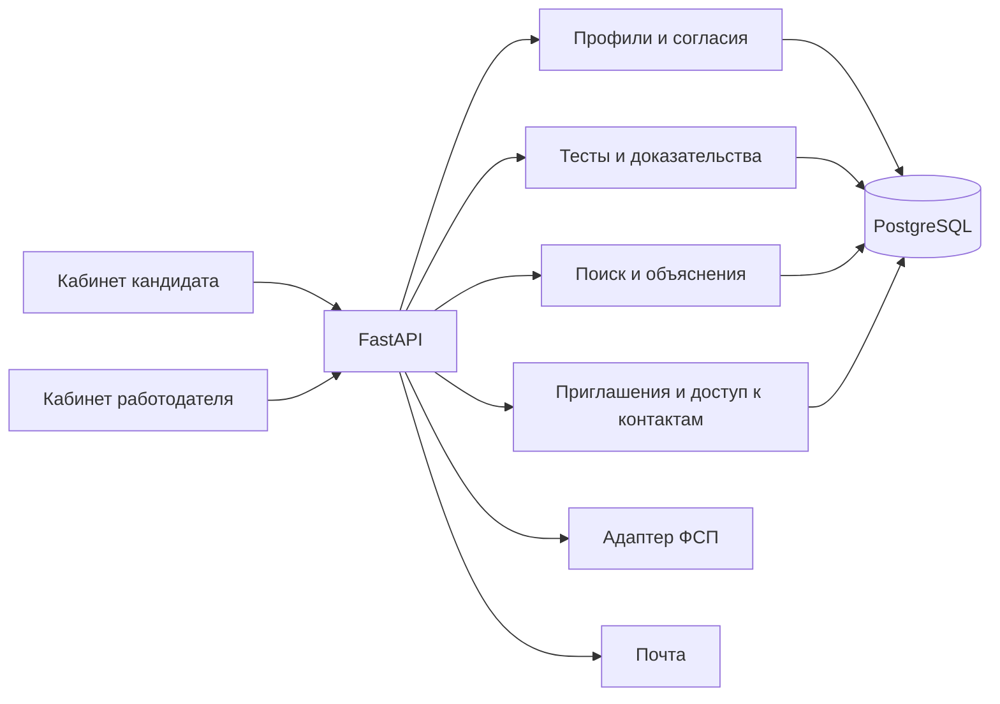

# Исторический план и принятые решения

Обновление 7 октября: приложение реализовано; фактическое состояние см. [IMPLEMENTATION_STATUS.md](IMPLEMENTATION_STATUS.md). Оценки сроков ниже сохранены как план, а не журнал выполненной работы.

# План решения спецтрека ФСП

**Решение: взять готовый технический каркас, а собственную работу сосредоточить на подтверждении навыков и обратном найме.** Заимствование инфраструктуры экономит время. Победная заявка должна показать, почему конкретный работодатель получил конкретных кандидатов и насколько можно доверять их проверке.

План составлен 7 октября 2026. Предполагаем одного участника с помощью ИИ; число людей в команде не подтверждено. Оценки времени — рабочие ориентиры, а не обещание скорости. Дедлайн из сообщения организаторов — 11 октября 23:59 МСК; внутренняя загрузка — к 20:00. Промежуточный срок отдельно сверить на платформе.

На момент составления первоначального плана были готовы анализ ТЗ, обзор компонентов и исследовательский симулятор. С тех пор реализовано приложение и подготовлен комплект материалов; текущие проверки и оставшиеся внешние шаги перечислены в IMPLEMENTATION_STATUS.md.

## 1. Что именно строим

Работодатель получает короткую подборку людей, которым подходит предложение и чьи нужные навыки подтверждены. Он видит основания рекомендации, предлагает условия и зарплату. Кандидат решает, открывать ли контакт. Повторные проверки навыков создают переносимое подтверждение, которое можно использовать в следующих подборках.

Показательный сценарий:

1. Кандидат регистрируется, подтверждает email, заполняет профиль и предпочтения, даёт согласие на публикацию.
2. Выбирает специализацию и предполагаемый грейд. Проходит понятную проверку; видит результат, основания и дальнейшие действия.
3. Работодатель пишет: «Python backend, API и SQL, Middle, удалённо, 180–250 тыс. RUB». Система предлагает структурированный запрос, который работодатель подтверждает.
4. В выдаче — категория, проверенные навыки, подтверждённые достижения и короткое объяснение. Например: «API подтверждён двумя семействами, SQL — одним; формат работы совпадает». Контакты скрыты.
5. Работодатель отправляет адресное предложение без публикации вакансии. Кандидат видит компанию, описание, вилку и способ связи; принимает или отклоняет.
6. После принятия именно этот работодатель получает контакт. Другой работодатель по-прежнему его не получает.

**Главный продуктовый акцент:** объяснимый выбор по доказательствам навыков и взаимным условиям, прозрачное предложение до общения, повторное использование подтверждений. Уникальность для конкурса нужно показывать этим сценарием и измерениями. Нельзя утверждать, что обратный найм или адаптивное тестирование изобретены нами.

## 2. Почему каркас, а не переписывание готовой ATS

| Путь | Что выигрываем | Что рискуем потратить | Выбор |
|---|---|---|---|
| Всё с нуля | Полный контроль | Дни на вход, формы, БД, сборку и деплой | Не выбран |
| Большая готовая система найма | Много готовых экранов | Переделка чужой модели ролей, воронки, контактов и интеграций | Только если пробный запуск покажет явное сокращение работ |
| Технический каркас + нужные библиотеки | Готовые общие части и свобода предметной модели | Изучение небольшой базы и точечные доработки | **Основной путь** |

Предпочтительная база — [официальный Full Stack FastAPI Template](https://github.com/fastapi/full-stack-fastapi-template). README и маршруты пользователей прочитаны, локальный запуск ещё не проведён. Перед копированием закрепить конкретный SHA и сохранить MIT license. Рекомендация условна до проверки запуска: если за 60–90 минут не получается воспроизводимая база, уменьшить состав сервисов, а не чинить необязательную инфраструктуру весь день.

Правило пользователя для **каждого блока**: поиск готового → чтение лицензии и нужного кода → минимальный запуск → наша адаптация → проверка → интеграция. [Реестр](REUSE_REGISTER.md) содержит стартовые источники, ограничения и необходимые проверки. Правило закреплено в [AGENTS.md](../AGENTS.md), чтобы оно сохранялось при дальнейшей работе.

## 3. Объём до дедлайна

**Обязательный объём:** два кабинета, подтверждение email, ручной профиль и PDF-экспорт, тест и категория, история/смена грейда, поиск с объяснениями, приглашения с зарплатой, разрешение на контакты, приватность, демонстрационная связь ФСП, воспроизводимый запуск и документация.

Для содержательного MVP — две специализации: Python backend и работа с данными/SQL; два грейда: Junior и Middle. Это наше ограничение демонстрационного покрытия, разрешённый ТЗ самостоятельный справочник. Остальные направления не показывать как уже проверяемые. Первый вертикальный сценарий можно собрать на одной специализации и затем расширить банк.

**После обязательного пути:** импорт PDF, открытые вакансии и самостоятельные отклики, один короткий дополнительный тест, аккуратная мобильная версия. Из них сначала брать то, что успевает пройти сквозную проверку.

**После хакатона:** промышленная калибровка, настоящий реестр ФСП, Keycloak, ATS, полноценный исполнитель кода, многоязычные тесты, обучение моделей на реальных результатах. Их отсутствие не закрывать декоративными кнопками.

Соответствие каждому пункту ТЗ — в [матрице R01–R28](REQUIREMENTS.md).

## 4. Архитектура и данные

Модульный монолит: React → FastAPI → PostgreSQL. Модули backend: identity, profiles, assessment, evidence, matching, invitations, integrations. Один сервис приложения и БД; SMTP как внешний адаптер. Исследовательский расчёт пока запускается отдельно. Очередь добавлять только при измеренной необходимости, не ради схемы.

| Сущность | Минимальные данные и инвариант |
|---|---|
| User / EmailVerification | email, hash пароля, роль, email_verified_at; токен одноразовый с назначением и сроком; смена email сбрасывает подтверждение |
| Candidate / CandidateContacts | разделить публичную часть и контакты; контакты не входят в общий ответ профиля |
| Consent / PublicationSettings | версия текста, время, цели, публикация, разрешённые поля; выключение публикации убирает профиль из новых поисков |
| Company / Membership | компания и владелец; для MVP один ответственный работодатель, расширение членства отдельно |
| Taxonomy / GradeRubric | специализация, навыки, грейд, версия рубрики; результат воспроизводим для своей версии |
| ItemFamily / ItemVariant | проверяемый навык, конструкция задачи, диапазон параметров, difficulty_band, эталон, версия, seed; правильный ответ не отдаётся до завершения |
| AssessmentAttempt / Answer | заявленный уровень, выбранные варианты, результат, причины; незавершённая попытка восстанавливается после обновления страницы |
| GradeAward / Evidence | присвоенная категория отдельно от попытки; источник, дата, семейство, версия проверки; неизменяемая история |
| FspIdentity / Achievement | внешний идентификатор, источник, статус подтверждения, время; demo и verified различаются в модели и UI |
| EmployerNeed / SavedSearch | обязательные и желательные навыки, условия, диапазон оплаты, версия запроса и сохранённые результаты |
| Invitation / ContactGrant | адресат, компания, условия, зарплата, статус, версия; grant связан с конкретной парой, создаётся транзакцией принятия |
| AuditEvent | кто и когда изменил критическое состояние; без токенов, паролей и полных контактов в журнале |

Идентификаторы и внешние связи — отдельные поля. Миграции обратимы там, где это возможно; seed-данные идемпотентны и помечены как демонстрационные.

Пример границ API: регистрация/подтверждение; чтение/изменение своего профиля; старт/ответ/завершение теста; создание потребности; поиск и сохранение подборки; создание/принятие/отклонение приглашения; отдельный разрешённый доступ к контактам; PDF-экспорт из того же разрешённого представления. OpenAPI генерируется из реальных маршрутов. Ошибки 401/403, конфликт 409, неверный ввод 422 и истёкшее состояние описать в контракте.

## 5. Проверка навыков: сначала измеримость

### Первичный грейд

Грейд присваивается по фиксированной версионированной рубрике специализации. Спрос конкретного работодателя, зарплата, ФСП ID и число приглашений не меняют его. Порог и обязательные навыки определяем до итоговой проверки, затем показываем ограничения этой рубрики.

Банк для MVP: ориентир 6 семейств на специализацию, варианты для двух уровней и несколько наборов параметров. Это план объёма, не уже созданные задания. Каждое семейство имеет эталон решения и короткое объяснение проверяемого умения. Полезные форматы: анализ ошибки в коде; предсказание результата; выбор корректного исправления; SQL на конкретной схеме; разбор контрпримера. Нельзя считать количество вариантов количеством независимых измерений навыка.

Для каждой формы теста:

- одинаковое покрытие обязательных навыков и фиксированный бюджет;
- минимум несколько разных семейств, без повторения уже показанного варианта;
- заранее проверенные ответы, ограничения параметров и допустимые эквивалентные ответы;
- понятная обратная связь после завершения;
- пометка недостаточной проверки вместо выдуманной точной вероятности грейда.

LLM можно использовать для черновиков контекстов и заданий. В оценивание попадают только семейства, прошедшие проверку человеком/эталонными вычислениями. Простая замена чисел не гарантирует равную сложность; это проверяется пилотом. Контроль показов и независимые семейства уменьшают некоторые последствия распространения ответов, но не доказывают защиту от любого использования ИИ.

Правило грейда для MVP: первый успешный тест создаёт категорию. Неудачный первый тест оставляет статус «уровень пока не подтверждён» и предлагает добровольный более низкий уровень. Неудачная попытка действующего участника сохраняет текущий грейд. Смена уже присвоенного грейда — не чаще 90 дней (наше решение); первые неудачи и дополнительные короткие задания не запускают этот интервал. Успешный более высокий тест внутри интервала можно сохранить как результат с датой возможного изменения, без скрытого изменения категории. Добровольное понижение тоже подчиняется правилу смены. Эти состояния показать явно.

### Дополнительная проверка для подбора

Исследовательская идея: учитывать, что ответы на похожие задачи связаны общим знанием семейства. Выбирать следующую короткую проверку по тому, насколько она способна улучшить конкретную ограниченную подборку, а не только уменьшить неопределённость навыка.

Пример: SQL уже подтверждён несколькими разными способами; ещё один похожий SQL-вопрос мало полезен. Умение работать с транзакциями пока не проверено и критично для текущего запроса — короткая проверка этого умения может быть ценнее. Доказательство результата сохраняется и доступно для следующих запросов с согласия кандидата.

Математика, известные предшественники, код и отрицательные результаты приведены в [исследовательской записке](RESEARCH_NOTE.md). На 400 синтетических рынках основной эффект дал учёт семейств; дополнительная сложность выбора пар не получила убедительного подтверждения. Поэтому:

- в research основной кандидат на дальнейшую работу — одиночный выбор с учётом семейств;
- в продукте до калибровки — прозрачная рубрика и проверенные факты; вероятностная модель работает в экспериментальном режиме;
- парный выбор остаётся исследовательской абляцией, не обязательным обещанием MVP;
- дополнительные задания добровольны, с ограничением нагрузки; отказ не понижает грейд.

Дополнительно выведен и проверен точный способ переиспользовать расчёт назначения при проверке одного кандидата. Он не меняет модель качества и ускоряет не все размеры задачи: подробности и отрицательный пример есть в разделе 9 записки. Встраивать его следует только после измерений на реальном объёме MVP.

## 6. Подбор: понятная базовая версия и научное расширение

Начать с проверяемого алгоритма без обучения:

1. Ограничить выдачу опубликованными профилями с подтверждённой категорией. Применить обязательную специализацию, грейд и явно подтверждённые навыки. Не подменять отсутствие доказательства уверенным нулём способности: показать «не проверено».
2. Проверить совместимость условий, которые кандидат явно задал: формат, занятость, предпочтения оплаты. Если вилка не пересекается, исключить по строгому предпочтению или показать расхождение по мягкому; не угадывать согласие кандидата.
3. Внутри категории рассчитать прозрачную силу профиля. Стартовая гипотеза для сравнения: 0.85 × релевантные результаты проверок + 0.10 × релевантные подтверждённые достижения + 0.05 × свежесть дополнительных подтверждений. Каждый компонент нормирован; веса фиксируются до отложенной разметки. Это инженерные веса, не обученная вероятность успеха.
4. Ограничить влияние нескольких похожих подтверждений одного семейства: дополнительное доказательство учитывать с убывающим весом; точную функцию выбрать и проверить на dev-наборе. Не заменять это случайным «AI score».
5. Показать 2–3 причины и одно существенное ограничение, если оно есть. Причины строятся из сохранённых фактов, а не свободной генерацией LLM.
6. Сохранить запрос и подборку. При повторном открытии перепроверить публикацию и права; скрытый впоследствии кандидат не должен оставаться доступным из старого снимка.

ФСП — дополнительное подтверждение релевантных навыков, не пропуск в сервис. При равных остальных данных подтверждённое достижение усиливает профиль; отсутствие ФСП не делает человека недоступным.

Исследовательское расширение моделирует ограниченное распределение приглашений между обеими сторонами. Ограничение «один кандидат — одно приглашение за раунд» используется **только в симуляции**. ТЗ не запрещает пользователю получать несколько предложений. Нельзя незаметно перенести эту экспериментальную модель в бизнес-правила.

Для NLP достаточно нормализации текста в справочник с возможностью исправления. Embeddings или LLM подключать, если они улучшают отложенную релевантность и не делают демонстрацию зависимой от недоступного API. Заявление «вероятность найма 94%» без данных о найме запрещено.

Дополнение 7 октября, v2: реализован отдельный режим устойчивой пятёрки с
общими приоритетами, ограничением номинальной потери и уточняющим вопросом.
Это не предыдущее исследование назначения один-к-одному. [Результаты и
доказательства](MATCHING_V2.md) показывают снижение worst-case и ухудшение
среднего результата относительно сильного baseline; обычный поиск остаётся
по умолчанию. Независимую релевантность найма это дополнение не закрывает.

Дополнение после v3/0.4.2: [аудит способов ввода](ELICITATION_AUDIT_0_4_2.md)
добавил прямые веса и фиксированные вопросы как контроль. Приоритет B05 —
явный числовой ввод с определённой шкалой наряду с уточнениями. До интеграции
нужно проверить обработку пустых/нулевых/недопустимых весов, сохранение,
восстановление, обязательные фильтры, грейд и контакты. Ни один способ не
объявляется лучшим по удобству или найму без человеческой оценки.

Исполнение этого шага: [0.4.3, прямые приоритеты](DIRECT_WEIGHTS_0_4_3.md).
Изолированный прототип и интеграционные проверки PASS, ввод/сохранение/
восстановление/переключение способов проверены через UI. Нагрузка нового
режима и оценка людьми NOT RUN; прежние исследования не перенастраивались.

## 7. Блоки реализации и критерии готовности

Время — ориентир активной работы одного участника с ИИ; не включает ожидание людей и внешнего хостинга. Базовые блоки суммарно около 39–58 часов. Для одного человека к 11 октября это напряжённый объём: уменьшать вариативность и дополнительные функции, сохраняя обязательный путь.

| Блок | Зависимости / готовое | Объём, часы | Что должно работать к завершению |
|---|---|---:|---|
| B01. Каркас и схема | U01; поиск до 60 мин | 2–3 | Чистый запуск, БД, миграции, два входа в роли, конфигурация без секретов. R01/R19/R20 |
| B02. Email, права, согласия | B01; U02–U03; поиск 30 мин | 3–4 | Подтверждение, одноразовость, разграничение API, публикация по согласию. R02/R08/R09/R22 |
| B03. Профили и PDF | B02; U04/U06; поиск 30 мин | 3–4 | Ручной профиль кандидата/компании, редактирование, PDF с правильной видимостью. R03/R10/R17 |
| B04. Проверка и категория | B01–B03; U07–U09; поиск 40 мин | 7–10 | Версионированный банк, эталоны, несколько форм, попытки, категория, история и cooldown. R04–R06 |
| B05. Потребность, поиск, объяснения | B03–B04; U10; поиск 30 мин | 4–6 | Категория по тесту, фильтры, объяснение, сохранение подборок; подготовлен базовый набор оценки. R11–R13 |
| B06. Дополнительная проверка | B04–B05; U11–U12 | 0 в обязательном пути; 3–5 при резерве | Экспериментальный выбор задания отдельно от грейда; сравнение с baseline; нет неподтверждённых обещаний. O02 |
| B07. Приглашения и контакт | B02/B03/B05; U13; поиск 20 мин | 4–5 | Вилка RUB, приглашение без вакансии, статусы и contact grant; два работодателя проверены. R14–R17 |
| B08. ФСП и интеграционные границы | B03–B05; U14; поиск 20 мин | 2–3 | Пустая история не ломает путь; демо-достижения явно подписаны; схема будущей интеграции. R07 |
| B09. Оценка, сценарии, нагрузка | Начинается с B04; U15/U16 | 7–12 | Измерены релевантность, стабильность/экспертная оценка при доступности людей; все обязательные сценарии; реальные ограничения. R18/R23/R26 |
| B10. Сдача и репетиция | Постепенно со B01; U17 | 7–11 | Рабочая ссылка либо видео, воспроизводимость, DOC/PDF, PPTX/PDF, обязательные слайды, открывающиеся ссылки. R19/R21/R24–R28 |

Если новый компонент требует отдельного аккаунта, оплаты или недоступного секрета, подготовить адаптер и конфигурацию, а реальную интеграцию завершать после получения нужного доступа. До этого не обозначать её работающей.

## 8. Порядок по дням

| Когда | Основная работа | Проверяемый результат |
|---|---|---|
| 7 октября | B01–B03; контракты B04/B07; первый тест с эталоном; черновик обязательных слайдов | Вход → профиль → один настоящий тест → сохранённый результат. Проверить промежуточный срок |
| 8 октября | B04; B05; B07 начинать по уже заданному контракту | Одна специализация проходит весь путь до принятого приглашения; контакты до принятия отсутствуют |
| 9 октября | Довести B05/B07/B08; второе направление; формы повторного тестирования; начать пилот | Обязательный путь обеих ролей закончен; воспроизводимый демо-набор, первая таблица качества |
| 10 октября | B09, исправления, B10; при запасе времени один дополнительный сценарий | Кандидатная сборка, видео, черновой PDF документации и презентация; репетиция без редактора кода |
| 11 октября до 15:00 | Финальные исправления только блокирующих проблем, чистый запуск, экспорт документов | Зафиксированная версия и запасное видео; фактические числа на слайдах |
| 11 октября 15:00–20:00 | Финальная репетиция и загрузка | Проверены ссылки, доступы, вложения и подтверждение приёма |
| 11 октября после 20:00 | Резерв на проблемы сдачи | Не начинать новую функцию перед закрытием платформы |

Первый полный путь важнее количества экранов. Если к вечеру 8 октября он не работает, заморозить необязательные компоненты. Если к вечеру 9 октября остаются проблемы с правами/приглашениями, B06 и O01 отменяются. При отсутствии SMTP в публичном окружении честно показывать локальную проверку почты и фиксировать ограничение; не отключать требование подтверждения тайно.

## 9. Валидация, которую жюри сможет проверить

**A. Корректность приложения.** Сквозные сценарии: новый кандидат без ФСП; кандидат с демо-историей; неудачный тест выше; добровольный тест ниже; ограниченная смена грейда; работодатель без вакансий; несовместимая зарплата; принять/отклонить; повтор запроса; чужие IDs; отозванная публикация; PDF до/после разрешения. Для приватности обязательно проверять тело API, а не только скрытую кнопку.

**B. Качество подбора.** Подготовить, например, 20 потребностей × 30 профилей = 600 пар с известным происхождением. Разделять dev/test по потребностям и семействам профилей до подбора весов; не использовать генератор собственного score как «эксперта». Два предметных оценщика независимо отмечают 0/1/2 (не подходит/нужна проверка/подходит), отдельно проверяют условия кандидата, обсуждают расхождения после исходной разметки. При отсутствии оценщиков результаты считаются синтетическими, это указывается явно.

Сравнить: совпадение слов, структурированные фильтры + простой балл, наш учёт подтверждений. Метрики: Precision@5, nDCG@5, доля нарушений обязательных условий, покрытие кандидатов, число повторных приглашений одному человеку. Считать неопределённость по запросам, не по 600 зависимым парам. Цель MVP: ноль нарушений жёстких условий; остальные целевые значения установить после dev-набора и заморозить, а не приписывать заранее.

**C. Проверка грейда.** Реалистичный разведочный пилот — 8–15 добровольцев разной подготовки и 1–2 специалиста. Две сопоставимые формы в сбалансированном порядке A/B; фиксировать перерыв и помнить эффект обучения. Эксперт оценивает отдельную практическую работу, не видя балла системы. Показать agreement/матрицу ошибок, совпадение повторного грейда, разброс времени, различимость заданий, трудные и неоднозначные вопросы. Такая выборка выявляет дефекты, но не сертифицирует систему.

**D. Распространение ответов.** В синтетике сравнить независимые ответы и знание семейства. В добровольном пилоте можно дать часть образцов/ответов перед новой формой и сравнить перенос на другие семейства; при малой выборке сообщить только наблюдения. Не выдавать статистический сигнал за обвинение конкретного человека. Влияние внешнего ИИ требует отдельного эксперимента.

**E. Техническая проверка.** Ориентир команды: 30 одновременных пользователей, p95 обычного профиля/поиска до 2 секунд на указанном сервере, отсутствие неожиданных 5xx. Это наши цели, не числа из ТЗ. Измерить на фиксированном объёме данных; длительные PDF/эксперименты отдельно. Проверка запуска — из чистой копии по инструкции.

**F. Научная симуляция.** Уже выполнена отдельно: 400 отложенных синтетических рынков, 6 методов, 5 условий, всего 2400 прогонов; [сырой результат](../research/results/test_v1.json). Это не результат тестов людей и не Precision@5 реального продукта.

## 10. Демо, документы и презентация

Готовить с первого дня короткую историю: «проверил навыки → получил категорию → нашёл кандидата по доказательствам → показал условия → получил согласие на контакт». Примерное распределение 4–5 минут: проблема и предложение 30 с; путь кандидата 60 с; работодатель/приглашение 90 с; механика и измерения 60 с; границы и развитие 30 с. Точный лимит выступления из имеющихся материалов неизвестен, подстроить после проверки регламента.

Сохранить исходные заготовки 7–11: титул; команда/суть/уникальность; участники; история/мотивация/сложности; техническая суть/развитие. Не выдумывать ФИО, опыт, контакты и пилот. После них — схема пути, демонстрация, механизм проверки, механизм подбора, измерения и ограничения. Исследовательские формулы вынести в резерв; на основных слайдах показать смысл и один честный график.

Финальный пакет:

- репозиторий с точной версией, README, .env.example, миграциями, демо-данными, инструкцией тестов и лицензиями;
- ссылка на прототип и инструкции доступа; при невозможности — видео и воспроизводимый локальный запуск;
- PPTX и/или PDF презентации;
- документация в DOC/PDF: архитектура, тестирование/устойчивость, подбор/категории, процедура и результаты валидации, схема ФСП, API, библиотеки/версии, запуск;
- резервная локальная демонстрация, видео, сохранённые результаты измерений.

Этот файл сохраняет исходный план. Фактическая реализация и проверки — IMPLEMENTATION_STATUS.md; сопроводительная документация — TECHNICAL_RU.md и PDF в output/submission.

## 11. Риски и решения

| Риск | Как узнаём | Что делаем |
|---|---|---|
| Чужой каркас оказался тяжелее ожидаемого | Нет запуска за 60–90 мин | Упростить окружение/выбрать меньшую основу с тем же контрактом, сохранить предметные наработки |
| Красивый тест не измеряет заявленный грейд | Эксперты расходятся, формы дают разные результаты | Исправить семейства и рубрику; честно сузить покрытие; не маскировать проблему ML |
| Научная сложность съедает MVP | Сквозного пути нет к контрольной дате | Основной продукт работает на прозрачной рубрике; сложный алгоритм остаётся исследованием |
| Нет реальных пользователей/разметчиков | Пилот не подтверждён к 9 октября | Выполнить синтетическую процедуру и экспертный аудит доступных задач; статус human validation — NOT RUN |
| Нет API ФСП | Это известно из ТЗ | Явно демонстрационный адаптер и документированный контракт, без заявления о реальной проверке |
| Контакты попали в старый PDF/ответ | Проверка второго работодателя/старой ссылки | Устранить на сервере, отозвать кеш/файл; повторить приватностный сценарий перед сдачей |
| Недоступен хостинг | Нет рабочей внешней ссылки к 10 октября | Видео + чистый локальный запуск; не оставлять сдачу без проверяемого прототипа |
| Нет убедительной научной новизны | Близкие публикации/отрицательные абляции | Уточнить конкретный вклад; предъявить протокол и границы; не заявлять «впервые в мире» |

Вероятность победы числом оценить нельзя: нет данных о конкурентах, команде и защите. Практический способ усилить заявку — закрыть обязательный путь, доказать механизм по двум главным критериям и показать, где заканчиваются подтверждённые результаты.

Дополнение 7 октября, B05/B09: после отдельного замороженного эксперимента
интегрирован режим [подбора с уточняющими сравнениями v3](MATCHING_V3.md).
Ответы описывают предпочтения работодателя и не меняют грейды. Пользователь
сообщил, что независимых оценщиков пока нет; этот пункт остаётся NOT RUN,
технические тесты и синтетика его не заменяют.

Дополнение 7 октября, B04/B05/B09: [сохранение семейств в 0.4.4](EVIDENCE_PORTFOLIO_0_4_4.md).
Короткая форма обновляет только проверенные семейства той же рубрики; повтор
не увеличивает покрытие. Изолированный прототип, API, миграции и две ветви UI
PASS. Банк и пороги сохранены; калибровка на людях остаётся NOT RUN.

Дополнение B04/B09: [проверены внешние источники](EXTERNAL_DATA_AUDIT.md),
подготовлен [слепой пакет предметной проверки](EXPERT_REVIEW_READY.md).
Полученных ответов людей 0; подготовка формы не означает завершённую оценку.
