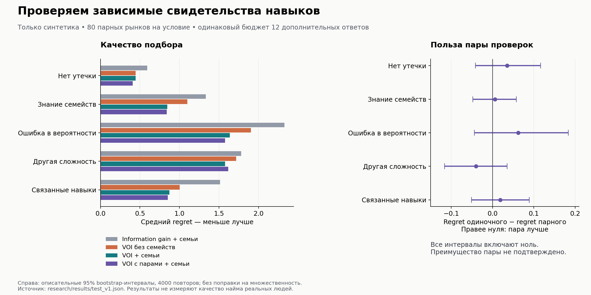

# Выбор проверок навыков с учётом семейства заданий и ценности для подбора

**Статус на 7 октября 2026:** собственная формализация и рабочий исследовательский прототип, предварительный синтетический эксперимент. Научная новизна относительно всей литературы не установлена; качество оценки и найма реальных людей не проверено. Это основа исследовательской заявки, не готовая доказанная технология оценки персонала.

## 1. Исследовательский вопрос

Можно ли при одинаковом бюджете ответов улучшить подбор, если одновременно:

1. не считать похожие варианты одного семейства независимыми доказательствами навыка;
2. выбирать следующую проверку по ожидаемому изменению решения о подборе;
3. учитывать совместимость условий и ограниченное число приглашений?

Дополнительная гипотеза: требования из нескольких обязательных навыков иногда требуют рассмотреть пару проверок вместе. Она проверена отдельно и не получила убедительного общего преимущества в данном эксперименте.

Потенциальный вклад для статьи — конкретная постановка активной проверки переносимых навыков при зависимых свидетельствах и ограниченном двустороннем подборе, анализ её поведения и открытый benchmark. Само сочетание известных методов ещё не доказывает публикационную новизну.

## 2. Ближайшие известные подходы

| Работа / первичный источник | Что уже известно | Чем ограничена наша претензия |
|---|---|---|
| [Behpour, Liu, Ziebart, ICML 2019: Active Learning for Probabilistic Structured Prediction of Cuts and Matchings](https://proceedings.mlr.press/v97/behpour19a.html) | Активное обучение для структурных задач, включая сопоставления, уже исследовано | «Задавать вопросы ради лучшего matching» не новое изобретение. Нужны сравнение точных постановок и отдельное обоснование модели свидетельств |
| [Yang et al., KDD 2024: Revisiting Reciprocal Recommender Systems](https://arxiv.org/abs/2408.09748) | Двусторонние рекомендации, системные метрики и переранжирование | Совместимость обеих сторон и ограничения нагрузки не объявляем новыми. В нашем эксперименте нет историй поведения и оценки причинного эффекта |
| [McLeod, Lewis, Thissen, 2003: Bayesian Detection of Item Preknowledge](https://www.ets.org/research/policy_research_reports/publications/article/2003/hjul.html) | Байесовское моделирование заранее известных ответов в адаптивных тестах | Предварительное знание заданий и Bayesian updating не наши изобретения. Изучены библиографическая карточка/аннотация, полный текст здесь не воспроизведён |
| [Jin et al.: Modeling Rapid Guessing Behaviors in Computer-Based Testlet Items](https://journals.sagepub.com/doi/10.1177/01466216221125177) | Зависимость внутри testlet и смешанные механизмы ответов — отдельная область психометрики | Наша конечная модель проще. Она не заменяет testlet IRT и не доказывает способность определять причины ответа человека |
| [Jiang et al., ICML 2017: Efficient Nonmyopic Active Search](https://proceedings.mlr.press/v70/jiang17d.html) | Учет будущих запросов и бюджета известен | Пара вопросов — ограниченная вычислительная эвристика, не новая общая теория планирования |
| [Sharpnack et al., AIME-Con 2026: S2A3](https://aclanthology.org/2026.aimecon-main.8/) | Bayesian CAT, работа с неопределённостью заданий и контроль показов развиваются в современных системах | Нельзя заявлять, что впервые объединили адаптивность, неопределённость и защиту банка. Здесь изучена аннотация, детали требуют отдельного чтения |
| [Michael et al., 2020: Global Sensitivity Analysis for the Linear Assignment Problem](https://arxiv.org/abs/2005.11792) | Анализ устойчивости назначения к изменению весов, в том числе предшествующие результаты для строк/столбцов | Разложение по одному изменяемому кандидату ниже — специализация известной структуры; не новый универсальный решатель |

Это адресный обзор, а не исчерпывающий систематический поиск. [Журнал источников](SOURCES.md) фиксирует границы чтения. Репозитории научных работ просмотрены как ориентиры; их результаты не объявляются воспроизведёнными.

## 3. Конечная модель свидетельств

Для кандидата i и навыка k вводим бинарное владение навыком θᵢₖ. Для каждого семейства f — скрытое предварительное знание Zᵢₖf. В текущей симуляции θ имеет prior π, Z — вероятность γ; семейства условно независимы. Если навык есть **или** семейство известно, вероятность правильного ответа равна r; иначе s, где r > s.

Здесь r = 0.90, s = 0.15, π = 0.50. Это параметры искусственного мира. Их нельзя переносить на реальных кандидатов без данных. Z не означает установленное мошенничество: похожее поведение может возникнуть из-за обучения, знакомого контекста и других причин.

Храним совместное распределение по состояниям (θ, Z₁, …, Z_F), а не заново усредняем Z при каждом ответе. Иначе повторные вопросы одного семейства искусственно умножают независимые подтверждения. В точной реализации на навык требуется 2^(F+1) состояний; при F = 3 это 16.

### Лемма о потолке свидетельства одного семейства

Если получено n правильных ответов одного семейства, по формуле Байеса:

$$
P(\theta=1\mid n\;\text{верных})
=\frac{\pi}{\pi+(1-\pi)[\gamma+(1-\gamma)(s/r)^n]}.
$$

Доказательство: при θ = 1 вероятность последовательности rⁿ; при θ = 0 она равна γrⁿ + (1−γ)sⁿ. Подставить в формулу Байеса и разделить числитель/знаменатель на rⁿ.

Поэтому при n → ∞:

$$
P(\theta=1\mid n\;\text{верных})\to
\frac{\pi}{\pi+(1-\pi)\gamma}<1 \quad (\gamma>0).
$$

При π = 0.5 и γ = 0.3 сколько угодно верных вариантов одного семейства дают предел около **0.769**. Это свойство нашей модели, а не оценка реального участника.

Для F независимых семейств с n_f правильными ответами:

$$
P(\theta=1\mid D)=
\frac{\pi}{\pi+(1-\pi)\prod_f[\gamma+(1-\gamma)(s/r)^{n_f}]}.
$$

В пределе большого числа ответов каждого семейства получаем π/[π+(1−π)γ^F]. Для трёх семейств при тех же параметрах — около **0.974**. Это объясняет, почему разнообразие конструкций может быть полезнее многократного изменения чисел.

Следствие для планирования банка: чтобы даже предельная уверенность могла достичь τ > π, необходимо γ^F ≤ π(1−τ)/[τ(1−π)]. Например, при π = 0.5, γ = 0.3, τ = 0.95 нужны как минимум три независимых семейства. Это необходимое условие для предела, не обещание, что три отдельных ответа уже достаточны.

Лемма и следствие — простой вывод для нашей заданной модели, не заявление о новом общем результате психометрики. Если семейства тоже связаны, γ неизвестна или списывание охватывает весь банк, формула перестаёт обосновывать заявленную уверенность.

## 4. Решение о подборе и выбор проверки

Для потребности j есть множество обязательных навыков Kⱼ и известная совместимость условий aⱼᵢ ∈ [0,1]. В эксперименте:

$$
w_{ji}(D)=a_{ji}\left(2\prod_{k\in K_j}P(\theta_{ik}=1\mid D)-1\right).
$$

Это ожидаемая искусственная полезность: +a при наличии всех навыков, −a при нехватке любого. Нулевую совместимость считаем запретом. При независимости навыков произведение корректно в модели; correlated_skills специально нарушает это предположение.

Назначение выбирает xⱼᵢ ∈ {0,1}, максимизируя сумму xⱼᵢwⱼᵢ, с ограничениями суммы по строке/столбцу ≤ 1. Дополнительные нулевые столбцы позволяют не приглашать никого. Решатель — готовый [SciPy linear_sum_assignment](https://docs.scipy.org/doc/scipy/reference/generated/scipy.optimize.linear_sum_assignment.html). Ограничения один-к-одному относятся к экспериментальному раунду, не к обязательным правилам платформы.

Обозначим оптимальное значение V(D). Для проверки q:

$$
\operatorname{VOI}(q\mid D)
=\sum_y P(y\mid D,q)V(D\cup\{q,y\})-V(D).
$$

Выбираем проверку с наибольшей ценностью. При равенстве используем information gain; так даже при нулевой краткосрочной ценности бюджет продолжает собирать сведения. В текущей реализации бюджет всегда задан заранее; адаптивная остановка по стоимости времени кандидата **не реализована**.

При точной модели, неизменном множестве допустимых решений и отсутствии цены вопроса VOI ≥ 0. Доказательство стандартное: после ответа можно сохранить старое решение; его ожидаемая ценность по всем ответам остаётся прежней по закону полного ожидания. Максимизация не хуже этого решения. Это не гарантия уменьшения фактической ошибки на каждом рынке и не гарантия оптимальности жадной политики.

### Зачем вообще рассматривалась пара

Один кандидат, одна потребность, два независимых навыка с вероятностями 0.5. Приглашение полезно +1, только если есть оба навыка, иначе −1. Разрешено отказаться. Начальная ожидаемая полезность приглашения −0.5, поэтому лучше отказаться.

Одна идеальная проверка навыка оставляет либо отрицательную, либо нулевую ожидаемую полезность: её VOI = 0. Две идеальные проверки находят пригодного кандидата с вероятностью 0.25; остальные исходы позволяют отказаться. VOI пары = 0.25. Это конкретный контрпример однопроверочной близорукости, не доказательство превосходства пар вообще.

В реализации пара выбирается до получения первого ответа; это **пакетный выбор двух вопросов**, а не полное двухшаговое адаптивное дерево. Для скорости берём две наиболее информативные доступные семьи каждого навыка одного кандидата; сравниваем пользу пары / 2 с пользой одиночного вопроса. Пары разных кандидатов, полноценная оптимизация оставшегося бюджета и переменная продолжительность вопросов не реализованы.

## 5. Зафиксированный эксперимент

Протокол записан в [research/PROTOCOL.md](../research/PROTOCOL.md). Код и протокол хешируются до запуска. Dev: seeds 0–19; первая отложенная проверка: 1000–1079. На каждом seed политики видят одинаковую заранее созданную истину и массив ответов. После просмотра test_v1 код алгоритма не подстраивался.

- 8 кандидатов, 4 потребности, 3 навыка, 3 семейства/навык, 3 варианта/семейство.
- Начально 24 ответа: по одному на навык каждого кандидата. Затем общий бюджет 12 ответов, не больше 6 дополнительных одному кандидату.
- Пять условий × 80 рынков = 400 экземпляров рынка; шесть политик = **2400 прогонов**. Между условиями используются те же номера seed; не считаем все 400 независимыми доказательствами одного эффекта.
- Политики: no_extra (без дополнительных ответов), random_naive (случайная проверка), information_family (information gain с той же моделью семейств), voi_naive (без знания семейств), voi_family, pair_voi_family.
- No_extra — более дешёвый ориентир, остальные методы получают одинаковый бюджет. Для отделения эффекта posterior особенно важны voi_naive / voi_family; для способа выбора — information_family / voi_family; для пары — voi_family / pair_voi_family.
- Основная метрика: regret — разница между полезностью оптимального назначения при известных истинных навыках и фактической полезностью выбранного. Меньше лучше. Это не процент точности и не частота трудоустройства.
- Дополнительно: Brier score вероятностей навыка, ошибочные приглашения, число приглашений/ответов, разнообразие семейств, время.
- Интервалы: 4000 парных bootstrap-повторов по рынкам, seed 20261007. Сравнения описательные, без поправки на множественность. Формальной процедуры доказательства превосходства заранее не заявлялось.

Условия: clean — без знания ответов; leakage — γ = 0.30; misspecified_leakage — истинная γ = 0.45, принятая γ = 0.20; shifted_items — реальные r/s отличаются по семействам; correlated_skills — зависимые навыки при независимой модели. Совпадение параметров модели с генератором в базовом условии намеренно облегчает задачу; стресс-сценарии лишь частично проверяют устойчивость.

## 6. Результаты первой отложенной проверки

Средний regret, меньше лучше:

| Условие | Без доп. ответов | Случайно | Information gain + семьи | VOI без семей | VOI + семьи | VOI с парами + семьи |
|---|---:|---:|---:|---:|---:|---:|
| clean | 1.251 | 0.962 | 0.592 | 0.444 | 0.444 | 0.409 |
| leakage | 2.340 | 1.918 | 1.335 | 1.101 | 0.846 | 0.840 |
| misspecified_leakage | 2.924 | 2.485 | 2.331 | 1.904 | 1.639 | 1.577 |
| shifted_items | 2.597 | 2.254 | 1.780 | 1.718 | 1.578 | 1.618 |
| correlated_skills | 1.939 | 1.720 | 1.514 | 1.003 | 0.871 | 0.853 |

В leakage разница information_family минус pair_voi_family: **0.495**, описательный 95% интервал **[0.291; 0.708]**. Отношение средних соответствует снижению regret примерно на 37.1%; это не рост точности найма на 37.1%. Против voi_naive разница **0.261 [0.060; 0.458]**.

Главная проверка необходимости пары:

| Условие | Regret одиночного минус парного метода | Описательный 95% интервал |
|---|---:|---:|
| clean | 0.036 | [−0.041; 0.116] |
| leakage | 0.006 | [−0.047; 0.058] |
| misspecified_leakage | 0.062 | [−0.044; 0.184] |
| shifted_items | −0.040 | [−0.116; 0.036] |
| correlated_skills | 0.019 | [−0.051; 0.089] |

Ни в одном условии этот интервал не исключает ноль. В shifted_items средний результат пары хуже. Поэтому нет основания рекламировать пары как подтверждённое улучшение; из-за стоимости выбираем одиночный вариант для следующего исследования. Это инженерное решение **после просмотра** результатов, не новый заранее подтверждённый научный вывод.

Оптимизация подбора не равно улучшению измерения всех навыков: например, в leakage Brier у information_family **0.135**, у voi_family **0.142**, у pair_voi_family **0.143**. В clean Brier у пары **0.093**, у information gain **0.078**. Вариант, полезный для конкретного подбора, может хуже описывать весь профиль — ещё одна причина отделять его от присвоения грейда.

В leakage среднее число ошибочных приглашений: 0.675 у voi_naive, 0.2875 у voi_family, 0.300 у pair_voi_family. Считать вместе с числом всех приглашений в сыром результате: стратегия могла снизить ошибки, чаще отказываясь от решения.

Время одного полного рынка с бюджетом 12 в текущем запуске: около 25–26 мс для voi_family и 61–79 мс для пары в зависимости от условия; p95 одиночного расчёта меньше 29 мс. Всего benchmark выполнялся около 54.3 с. Это локальный маленький эксперимент, не HTTP latency, не нагрузочный тест и не подтверждение масштабирования.

Полные числа, trace каждого ответа, версии и хеши: [test_v1.json](../research/results/test_v1.json). Таблицы всех метрик: [автоматический отчёт](../research/results/test_v1_tables.md). Dev-результаты сохранены отдельно; график строится по test.

## 7. Реализация и независимые проверки

Основной код — [core.py](../research/core.py), запуск — [run_benchmark.py](../research/run_benchmark.py). Использованы Python 3.14.7, numpy 2.4.4, scipy 1.18.1. Версии относятся к исследованию, не к будущему web-стеку.

Шесть тестов проверяют: совпадение оптимизатора с полным перебором маленьких задач; аналитический потолок одного семейства; сумму вероятностей и сохранение prior при усреднении будущих posterior; неотрицательность VOI; контрпример двух навыков; воспроизводимость ответов/ограничения бюджета/отсутствие повторов вариантов. Они прошли. Это математические и программные проверки, не психометрическая валидация.

При Q допустимых одиночных запросах одна итерация требует порядка Q решённых назначений с множителем числа исходов (два). Перебор пар увеличивает число запросов и даёт четыре исхода на пару. Точный posterior экспоненциален по числу семейств. На большом банке нужны локальные состояния/аппроксимации, кеширование и отдельная оценка ошибки; это пока не реализовано.

## 8. Что нужно для статьи и внедрения

1. **Довести обзор близкой литературы.** Прочитать полные тексты ближайших работ, проследить их ссылки и цитирования. Чётко показать, какая постановка/гарантия/эксперимент отличается. Если отличия прикладные, так и позиционировать статью.
2. **Проверить идентифицируемость.** Отделить навык, знакомство с семейством и трудность задания по реальным ответам непросто. Нужны независимые контрольные задания и анализ чувствительности к γ, а не «магическая» фиксированная вероятность 0.30.
3. **Усилить сравнение без подгонки.** Семейно-сбалансированный round-robin, случайный выбор с тем же posterior, сильный CAT/testlet baseline, точное решение маленького полного планирования. После фиксации новой версии — новые test seeds; test_v1 больше не невидимый набор.
4. **Расширить условия.** Связанные утечки между семействами, перенос выученного ответа на новый шаблон, отказы от теста, разная длительность, новые потребности, ограничения нагрузки, общие ошибки ключа. Не ограничиваться миром, для которого наш метод построен.
5. **Собрать независимую проверку людей.** Раздельные авторы задач и разметчики; заранее заданные пороги; разделение по людям и семействам. Пилот 8–15 человек нужен для обнаружения ошибок; достаточный объём следующего исследования рассчитывать по вариативности и эффекту пилота.
6. **Проверить полезность для обеих сторон.** Не только offline-score, но время до подходящего предложения, доля принятых приглашений, нагрузка проверками и понятность объяснений. Не проводить автоматические реальные кадровые решения на основании этой симуляции.
7. **Воспроизводимость.** Открытые генераторы, параметры, отрицательные результаты, лицензии, зафиксированные версии и полная таблица абляций. Никаких замен неудачных запусков удачными без отчёта.

Для хакатона уже можно честно показать сформулированную модель, аналитический эффект зависимости, проверенный код, сравнение с базовыми методами и ограничения. Для сильной статьи одного этого синтетического эксперимента недостаточно.

## 9. Дополнение: точный расчёт ценности без повторного полного назначения

Это отдельное вычислительное дополнение после test_v1. Оно сохраняет смысл VOI; результаты качества выше не пересчитывались.

Когда мы проверяем одного кандидата i, меняется только столбец его весов. Обозначим Cᵢ — лучший результат без этого кандидата, Rⱼᵢ — лучший результат без этого кандидата и работодателя j. Тогда для любого нового столбца:

$$
V(w'_i)=\max\left(C_i,\max_j\{R_{ji}+w'_{ji}\}\right).
$$

**Доказательство.** В допустимом назначении кандидат i либо не назначен — тогда максимум Cᵢ, либо назначен ровно одному j. После фиксирования этой пары остаётся независимая задача без строки j и столбца i со значением Rⱼᵢ. Максимум по всем случаям исчерпывает допустимые назначения.

Можно заранее вычислить C/R и переиспользовать их для всех семейств, навыков и возможных исходов проверки этого кандидата. Это работает и для пары вопросов ему же. Подготовка кеша требует n(m+1) вызовов решателя плюс базовый; обработка каждого нового исхода после подготовки — максимум по m числам и вычисление нового столбца. Кеш нужно строить заново после фактического изменения общего состояния.

Никакой аппроксимации назначения здесь нет. Но большое число работодателей может сделать подготовку дороже прямого расчёта. При вопросах разным кандидатам одновременно этот простой кеш неприменим: там меняется несколько столбцов.

### Сертификат бесполезной одиночной проверки в модели

При изменении вероятности одного навыка p остальные параметры фиксированы. Вес каждой затронутой пары линеен по p, поэтому:

$$
V_i(p)=\max\{C_i, a_1+b_1p,\ldots,a_m+b_mp\}.
$$

Если одна и та же линия оптимальна на обоих концах интервала возможных posterior p⁻…p⁺, она оптимальна на всём интервале. Тогда V_i линейна на нём. Поскольку средний posterior равен prior, ожидаемое V после вопроса равно текущему V: **VOI = 0**.

Это даёт проверяемое объяснение: вопрос может уточнять навык, но не менять решение о конкретной подборке. Положительная ценность появляется при пересечении границы между решениями. Сертификат относится только к заданной вероятностной модели, а не к полезности вопроса для обучения или первичной оценки грейда. Явное отсечение запросов по сертификату пока не включено в код; реализовано точное разложение назначения.

Код: [fast_voi.py](../research/fast_voi.py). Отдельный [протокол](../research/CACHE_PROTOCOL.md) задан до нового запуска; проверяются точное совпадение и время с включённой стоимостью подготовки, а не новое преимущество по качеству. Три дополнительные проверки сравнивают замены столбцов с полным решателем, одиночные/парные VOI и отказ для нескольких кандидатов.

Вычислительная проверка завершена: 60 состояний, seeds 2000–2019 для каждого размера. Максимальное абсолютное расхождение VOI — **3.56 × 10⁻¹⁵** (округление вверх). Время включает подготовку кеша; ниже медиана отношения времени прямого метода к кешированному, больше 1 означает ускорение.

| Кандидатов / потребностей | Только одиночные вопросы | Одиночные + все заданные пары |
|---|---:|---:|
| 8 / 4 | 1.16× | 1.25× |
| 40 / 8 | 1.14× | 1.37× |
| 120 / 40 | **0.49× — замедление примерно вдвое** | 1.55× |

Это полезная точная специализация, но не универсальное ускорение. На основном одиночном методе выигрыш ограничен; нельзя добавлять кеш без учёта размера задачи. Встроенный выбор между двумя реализациями и проверка сквозной политики пока не реализованы. [Все измерения и хеши](../research/results/cache_v1.json) сохранены отдельно от test_v1. Поскольку quality-бенчмарк не менялся, эти числа не означают нового улучшения качества подбора.
