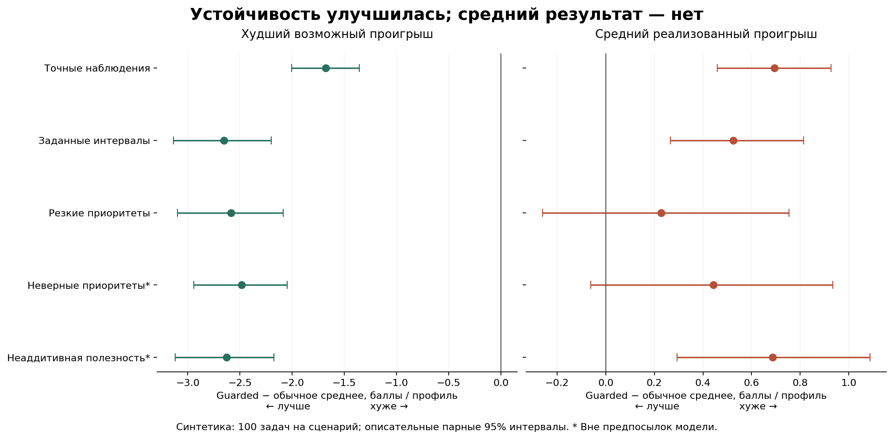

# Фактические результаты robust top-k v2

7 октября 2026. Синтетика, не качество найма людей.

Протокол и хеши зафиксированы до heldout. 500 задач = 5 сценариев × 100 независимых seeds; 18 профилей, 3 признака, k=5. 3500 запусков семи методов и 2000 записей двух стратегий вопроса с/без ограничения. Python 3.14.7, NumPy 2.4.4, SciPy 1.18.1/HiGHS 1.12.0. Отчёт: Matplotlib 3.10.8.

**Вывод:** снижение худшего regret не означает улучшение среднего результата. Guarded без вопроса уступает среднему ранжированию по средней реализованной потере. Основной режим приложения не заменён. Полезность уточнений перспективна, но нужна честная проверка с одинаковым объёмом информации и на реальных задачах.

## Все методы, все сценарии

Regret ниже лучше; nDCG/пересечение выше лучше. Regret здесь сумма полезностей пяти профилей, максимум 5; в UI показывается 100R/k баллов в среднем на профиль.

| Сценарий | Метод | Худший R | Реализованный R | nDCG@5 | Пересечение top-5 | p95 расчёта, с |
|---|---|---:|---:|---:|---:|---:|
| Точные наблюдения | evidence_v1 | 0.5252 | 0.1248 | 0.9675 | 0.672 | 0.000 |
| Точные наблюдения | guarded | 0.3626 | 0.1002 | 0.9732 | 0.710 | 0.028 |
| Точные наблюдения | independent_box | 0.4549 | 0.1071 | 0.9718 | 0.680 | 0.096 |
| Точные наблюдения | joint | 0.3555 | 0.1144 | 0.9705 | 0.688 | 0.043 |
| Точные наблюдения | lower_mean | 0.4465 | 0.0655 | 0.9802 | 0.760 | 0.000 |
| Точные наблюдения | mean | 0.4465 | 0.0655 | 0.9802 | 0.760 | 0.000 |
| Точные наблюдения | weights_only | 0.3555 | 0.1144 | 0.9705 | 0.688 | 0.043 |
| Заданные интервалы | evidence_v1 | 1.1562 | 0.1778 | 0.9502 | 0.600 | 0.000 |
| Заданные интервалы | guarded | 0.9233 | 0.1407 | 0.9595 | 0.652 | 0.097 |
| Заданные интервалы | independent_box | 1.0886 | 0.1601 | 0.9546 | 0.620 | 0.143 |
| Заданные интервалы | joint | 0.9082 | 0.1508 | 0.9575 | 0.638 | 0.169 |
| Заданные интервалы | lower_mean | 1.0555 | 0.1350 | 0.9607 | 0.644 | 0.000 |
| Заданные интервалы | mean | 1.0560 | 0.1145 | 0.9646 | 0.682 | 0.000 |
| Заданные интервалы | weights_only | 0.9915 | 0.1437 | 0.9589 | 0.640 | 0.048 |
| Резкие приоритеты | evidence_v1 | 1.1503 | 0.3053 | 0.9136 | 0.560 | 0.000 |
| Резкие приоритеты | guarded | 0.9266 | 0.2367 | 0.9290 | 0.624 | 0.107 |
| Резкие приоритеты | independent_box | 1.0965 | 0.2573 | 0.9247 | 0.566 | 0.125 |
| Резкие приоритеты | joint | 0.9141 | 0.2544 | 0.9254 | 0.610 | 0.164 |
| Резкие приоритеты | lower_mean | 1.0587 | 0.2466 | 0.9268 | 0.610 | 0.000 |
| Резкие приоритеты | mean | 1.0559 | 0.2252 | 0.9311 | 0.622 | 0.000 |
| Резкие приоритеты | weights_only | 0.9898 | 0.2476 | 0.9269 | 0.606 | 0.042 |
| Неверные приоритеты* | evidence_v1 | 1.0819 | 0.2427 | 0.9181 | 0.534 | 0.000 |
| Неверные приоритеты* | guarded | 0.8348 | 0.3197 | 0.9016 | 0.480 | 0.118 |
| Неверные приоритеты* | independent_box | 0.9344 | 0.3545 | 0.8934 | 0.440 | 0.120 |
| Неверные приоритеты* | joint | 0.8158 | 0.3300 | 0.8998 | 0.478 | 0.148 |
| Неверные приоритеты* | lower_mean | 0.9528 | 0.3253 | 0.9005 | 0.482 | 0.000 |
| Неверные приоритеты* | mean | 0.9590 | 0.2976 | 0.9061 | 0.500 | 0.000 |
| Неверные приоритеты* | weights_only | 0.8940 | 0.3625 | 0.8927 | 0.438 | 0.021 |
| Неаддитивная полезность* | evidence_v1 | 1.1679 | 0.2151 | 0.9372 | 0.626 | 0.000 |
| Неаддитивная полезность* | guarded | 0.9327 | 0.1750 | 0.9481 | 0.652 | 0.094 |
| Неаддитивная полезность* | independent_box | 1.0880 | 0.1039 | 0.9648 | 0.708 | 0.098 |
| Неаддитивная полезность* | joint | 0.9176 | 0.2116 | 0.9400 | 0.626 | 0.195 |
| Неаддитивная полезность* | lower_mean | 1.0776 | 0.1703 | 0.9493 | 0.650 | 0.000 |
| Неаддитивная полезность* | mean | 1.0642 | 0.1406 | 0.9560 | 0.688 | 0.000 |
| Неаддитивная полезность* | weights_only | 0.9906 | 0.1498 | 0.9539 | 0.674 | 0.040 |

* Два последних сценария нарушают предпосылки гарантии. Отсутствие наблюдаемых нарушений широкого bound в них не подтверждает пригодность модели. Есть отдельный явный контрпример: R=0 внутри неверно заданного W, реальная потеря 1 вне W.

## Вопросы и равный объём информации

| Сценарий | Метод | Реализованный R | nDCG@5 |
|---|---|---:|---:|
| Точные наблюдения | best_pair | 0.0549 | 0.9830 |
| Точные наблюдения | guarded_best_pair | 0.0480 | 0.9839 |
| Точные наблюдения | guarded_random_pair | 0.0662 | 0.9801 |
| Точные наблюдения | random_pair | 0.0857 | 0.9762 |
| Точные наблюдения | updated_mean_same_answer **post-hoc** | 0.0369 | 0.9879 |
| Заданные интервалы | best_pair | 0.1133 | 0.9659 |
| Заданные интервалы | guarded_best_pair | 0.1038 | 0.9673 |
| Заданные интервалы | guarded_random_pair | 0.1188 | 0.9642 |
| Заданные интервалы | random_pair | 0.1184 | 0.9643 |
| Заданные интервалы | updated_mean_same_answer **post-hoc** | 0.0854 | 0.9741 |
| Резкие приоритеты | best_pair | 0.1817 | 0.9413 |
| Резкие приоритеты | guarded_best_pair | 0.1829 | 0.9402 |
| Резкие приоритеты | guarded_random_pair | 0.2007 | 0.9362 |
| Резкие приоритеты | random_pair | 0.2056 | 0.9363 |
| Резкие приоритеты | updated_mean_same_answer **post-hoc** | 0.1519 | 0.9532 |
| Неверные приоритеты* | best_pair | 0.3012 | 0.9053 |
| Неверные приоритеты* | guarded_best_pair | 0.3038 | 0.9048 |
| Неверные приоритеты* | guarded_random_pair | 0.3069 | 0.9044 |
| Неверные приоритеты* | random_pair | 0.3003 | 0.9059 |
| Неверные приоритеты* | updated_mean_same_answer **post-hoc** | 0.3245 | 0.8976 |
| Неаддитивная полезность* | best_pair | 0.2083 | 0.9425 |
| Неаддитивная полезность* | guarded_best_pair | 0.1685 | 0.9502 |
| Неаддитивная полезность* | guarded_random_pair | 0.1698 | 0.9495 |
| Неаддитивная полезность* | random_pair | 0.2161 | 0.9401 |
| Неаддитивная полезность* | updated_mean_same_answer **post-hoc** | 0.1801 | 0.9411 |

Сравнение с mean без вопроса использует разный объём информации и не доказывает превосходство робастного ранжирования. updated_mean_same_answer добавлен после просмотра heldout и помечен post-hoc: это разведочный анализ тех же миров; код/метрики первоначального эксперимента не менялись. Для подтверждающего вывода нужен новый набор с заранее включённым baseline.

## Корректность и отрицательные результаты

- 58 независимых проверок PASS: углы признаков, полный перебор наборов, сужение W, guard, вырожденность и явный fallback. Тесты не заменяют предпосылки доказательств.
- Нарушений сертификата в in-model строках: 0; в строках вопросов: 0.
- Нарушений guard ε=0.05: 0.
- Один основной запуск weights_only / nonlinear_utility / seed 50089 получил bounded с gap 2.41345e−7; его результат оставлен. Две записи вопросов относятся к семьям с хотя бы одной не полностью оптимальной веткой. Не утверждаем optimum для каждого численного запуска.
- До heldout на dev найдено завышенное доверие к default точности HiGHS; tolerance ужесточён, добавлен независимый пересчёт. Dev-файлы сохранены, первая версия кода в archive/dev_v2.
- Guard уменьшил номинальные потери, но не устранил ухудшение среднего истинного результата. Метрики не отбирались по выгоде алгоритму.
- Bootstrap: 2000 парных повторов по независимым задачам, seed 202610071, описательные percentile 95% интервалы; без поправки на множественные сравнения. Все интервалы в heldout_v2.json.

Файлы PROOFS.md и DESIGN.md объясняют цель и происхождение метода; исходный benchmark не редактируется после просмотра. Все практические границы приложения перечислены отдельно в docs/MATCHING_V2.md.
